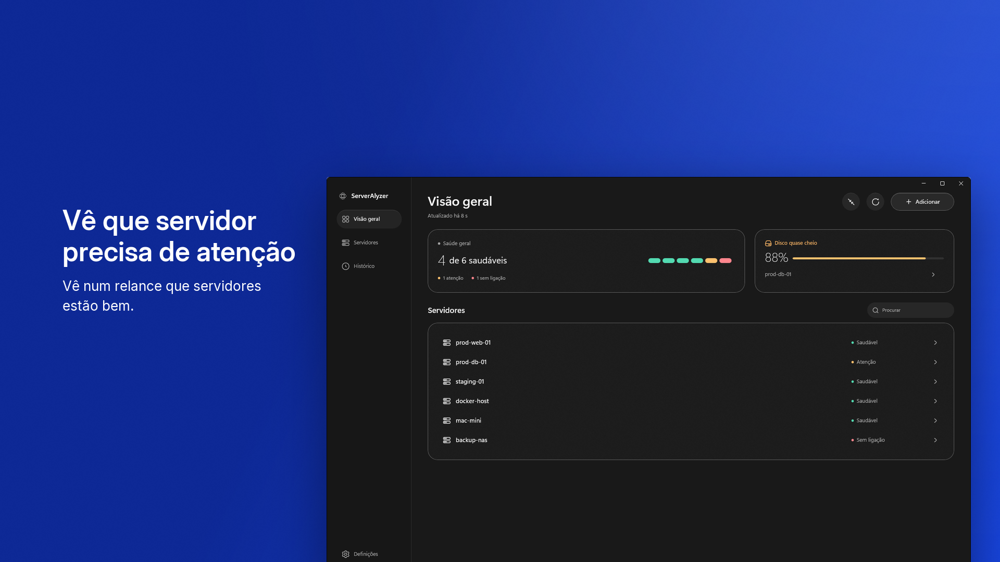
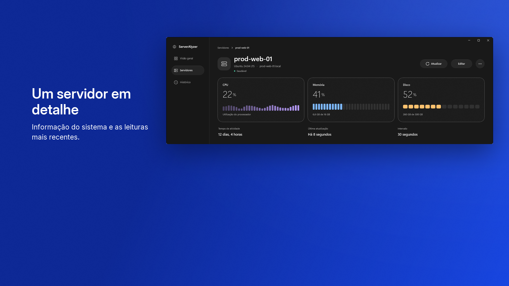
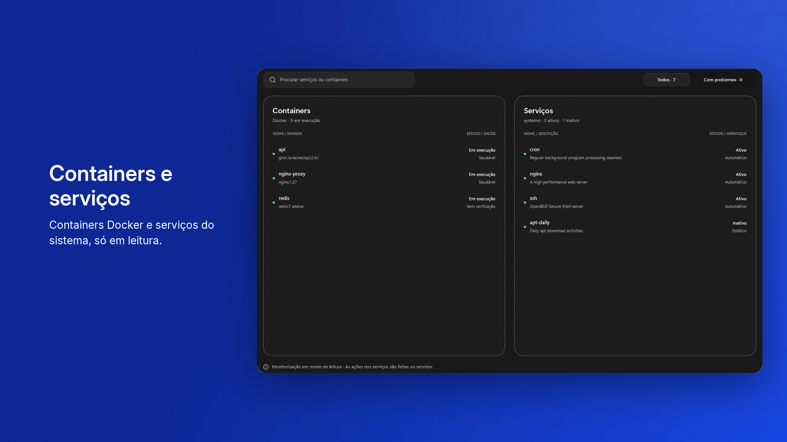
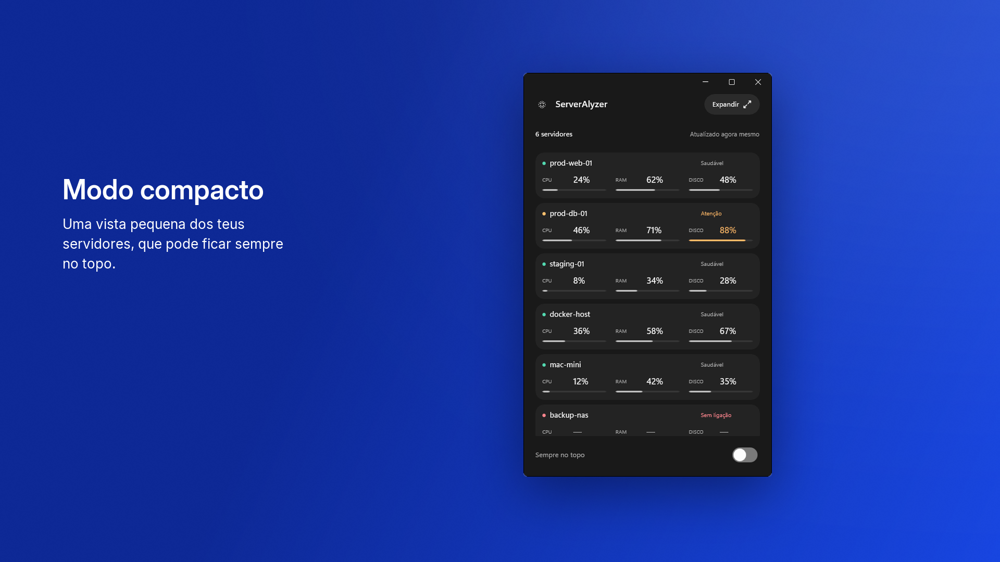

# ServerAlyzer

[](https://github.com/pedroloyola/ServerMonitor/releases/latest)
[](LICENSE)

**ServerAlyzer** é um painel calmo e compacto para Windows 11 que mostra o estado dos servidores Linux e macOS que
geres — CPU, memória, disco, tempo de atividade, histórico, containers Docker e serviços do sistema — através de ligações
**SSH diretas** a partir do teu PC.

É **local-first** e **open-source (MIT)**: não precisa de conta, não instala agentes nos servidores e não
recolhe telemetria. A monitorização acontece diretamente entre o teu computador e os servidores que configuras.

**Versão atual: 1.1.7** · [**Instalar a partir da Microsoft Store**](https://apps.microsoft.com/detail/9n6zbsbn1td2)
(gratuita, Windows 11 x64) · [Notas de versão](https://github.com/pedroloyola/ServerMonitor/releases/latest) ·
[Changelog](CHANGELOG.md)

## Capturas de ecrã

| Visão geral | Detalhe do servidor |
|---|---|
|  |  |
| **Serviços e containers (só leitura)** | **Modo compacto** |
|  |  |

## Funcionalidades

- **Monitorização por SSH** de servidores **Linux** e **macOS**, sem agente e sem conta.
- **CPU, memória, disco e tempo de atividade**, com estado de saúde por servidor. Quando um valor não pode ser lido, a app diz
  isso em vez de mostrar zero.
- **Histórico local** de CPU, memória e disco durante 30 dias, com gráficos da última hora aos últimos 30 dias.
- **Containers Docker e serviços** (systemd no Linux, launchd no macOS) em modo **só de leitura**: a app nunca
  inicia, para ou altera nada nos servidores.
- **Widget do Windows 11** no painel de Widgets (Win + W), em três tamanhos, que indica sempre há quanto
  tempo os dados foram lidos.
- **Área de notificação e notificações do Windows**: avisos quando o estado de um servidor muda; a
  monitorização pode continuar com a janela fechada.
- **Modo compacto**: uma vista pequena de todos os servidores que pode ficar sempre no topo.
- **Pesquisa na rede local só quando pedes** (mDNS/DNS-SD), sem varrer portas nem intervalos de endereços.
- **Configuração simples**: guia de início, servidores a partir do teu ficheiro de configuração SSH,
  teste de ligação passo a passo e suporte para um jump host (ProxyJump).
- **Cópia de segurança encriptada** dos servidores, chaves de host confiáveis e palavras-passe guardadas, protegida
  por uma frase-passe à tua escolha.
- **Idiomas**: inglês (en-US), português de Portugal (pt-PT) e português do Brasil (pt-BR).
- **Temas** Claro, Escuro e Sistema; navegação por teclado, leitores de ecrã e alto contraste.

## Instalação

O ServerAlyzer está disponível **gratuitamente na Microsoft Store**:
[apps.microsoft.com/detail/9n6zbsbn1td2](https://apps.microsoft.com/detail/9n6zbsbn1td2).
A Store trata da instalação e das **atualizações**. O runtime .NET vem incluído no pacote, por isso não precisas
de instalar o .NET.

Requisitos:

- **Windows 11 x64**.
- Para o widget: **Windows 11 22H2 (build 22621.1413) ou mais recente**, com as atualizações em dia. Em versões anteriores a aplicação funciona
  normalmente; apenas o widget não é oferecido pelo sistema.
- Servidores **Linux** ou **macOS** acessíveis por SSH a partir do teu PC. As listas de serviços precisam de
  `systemd` (Linux) ou `launchd` (macOS).

Este repositório **não** publica instaladores para download direto: as
[GitHub Releases](https://github.com/pedroloyola/ServerMonitor/releases) contêm as notas de versão e o código-fonte.
Para compilar a partir do código, vê [Compilar a partir do código](#compilar-a-partir-do-código).

## Primeiros passos

1. **Adicionar um servidor.** Abre a aplicação e segue o guia de início, ou escolhe **Adicionar**.
   Podes preencher os dados a partir de um host do teu ficheiro de configuração SSH.
2. **Autenticação SSH.** Escolhe **Palavra-passe** ou **Chave SSH** (chave privada, com frase-passe opcional).
   A aplicação sugere as chaves habituais da tua pasta `.ssh`. Só o **caminho** da chave é guardado, nunca o seu conteúdo.
3. **Confirmar a chave do host.** No primeiro teste de ligação, a aplicação mostra a **impressão digital SHA-256**
   da chave do servidor e pede a tua confirmação antes de confiar nele. Se a chave mudar mais tarde, a ligação é **bloqueada**.
4. **Consultar as métricas.** A **Visão geral** mostra o estado de todos os servidores; cada servidor tem uma
   página de detalhe com métricas, histórico, serviços e containers.
5. **Adicionar o widget.** No Windows 11 22H2 (build 22621.1413) ou mais recente, abre o painel de Widgets com **Win + W**, escolhe
   **Adicionar widgets** e seleciona o **ServerAlyzer**.

## Privacidade e segurança

A política de privacidade completa está em [`PRIVACY.pt-PT.md`](PRIVACY.pt-PT.md) (também em
[inglês](PRIVACY.md) e [pt-BR](PRIVACY.pt-BR.md)). Em resumo:

- **Dados da aplicação, no teu PC.** Servidores, chaves de host confiáveis, histórico, resumo do widget e
  preferências ficam numa pasta `ServerMonitor` nos dados locais de aplicações da tua conta. Numa instalação da
  Microsoft Store, o Windows pode guardá-la dentro da pasta de dados do pacote; se a pasta
  `%LOCALAPPDATA%\ServerMonitor` já existia antes da instalação (por exemplo, de uma versão de desenvolvimento),
  a aplicação continua a usá-la. Nada é sincronizado nem enviado ao editor.
- **Credenciais.** Palavras-passe e frases-passe SSH ficam no **Gestor de Credenciais do Windows**, nunca nos
  ficheiros de dados da aplicação; só entram, encriptadas, numa cópia de segurança se a criares.
- **Widget do Windows.** O conteúdo do cartão é entregue ao painel de Widgets, uma funcionalidade do Windows; o
  processo do widget não faz SSH nem acede a credenciais.
- **O que o editor pode receber.** Apenas o que decidires enviar (e-mail, issues ou relatórios de segurança no
  GitHub) e os relatórios e críticas que a Microsoft lhe mostra no Partner Center (não são telemetria da
  aplicação).
- **Serviços independentes.** A Microsoft (Store, Windows), o GitHub e os serviços de e-mail tratam dados segundo
  as suas próprias políticas.
- **Segurança SSH.** Sem confiança automática em hosts desconhecidos, conjunto fechado de comandos só de leitura,
  sem sudo, e texto remoto tratado como não confiável.
- **Desinstalação.** As credenciais no Gestor de Credenciais e eventuais regras da Firewall do Windows ficam até
  as removeres; se a aplicação usava uma pasta `%LOCALAPPDATA%\ServerMonitor` que já existia antes da
  instalação, essa pasta também fica. A política de privacidade explica como remover as credenciais e as regras.

Para reportar uma vulnerabilidade, usa os [GitHub Security Advisories](SECURITY.md) deste repositório; não abras um
issue público.

## Compilar a partir do código

Requisitos: **SDK .NET 10.0.402** (fixado em `global.json`, sem roll-forward), Windows 11 x64.

```powershell
# Build + testes
dotnet build ServerMonitor.slnx
dotnet test ServerMonitor.slnx

# Correr a app (unpackaged, self-contained)
dotnet run --project src/ServerMonitor.App

# Construir o pacote MSIX de produção (.NET self-contained; Windows App Runtime como framework package)
dotnet build src/ServerMonitor.App/ServerMonitor.App.csproj -c Release -p:Packaged=true
```

Um pacote MSIX construído localmente não é assinado pela Store: instalá-lo exige um certificado de teste e
destina-se apenas a desenvolvimento e QA, não a utilizadores finais.

Documentação técnica: arquitetura em [`docs/architecture.md`](docs/architecture.md), decisões em
[`docs/decisions/`](docs/decisions/) e resolução de problemas em [`docs/troubleshooting.md`](docs/troubleshooting.md).

## Contribuir

Contribuições são bem-vindas através de issues e pull requests. Reporta vulnerabilidades de forma responsável —
ver [`SECURITY.md`](SECURITY.md).

## Suporte e ligações

- [Microsoft Store](https://apps.microsoft.com/detail/9n6zbsbn1td2)
- [GitHub Releases](https://github.com/pedroloyola/ServerMonitor/releases)
- [Issues](https://github.com/pedroloyola/ServerMonitor/issues)
- [Segurança (`SECURITY.md`)](SECURITY.md)
- [Política de privacidade](PRIVACY.pt-PT.md)
- [Changelog](CHANGELOG.md)

## Licença

[MIT](LICENSE). Software de terceiros e respetivas licenças em [`THIRD-PARTY-NOTICES.md`](THIRD-PARTY-NOTICES.md).
